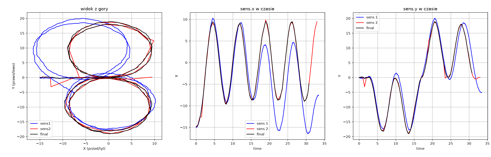

# PWRRT Zadania Rekrutacyjne

Repozytorium zawiera kody źródłowe, implementujące rozwiązania do podanych zadań.

Dodatkowe wyjaśnienia znajdują się bezpośrednio w kodach źródłowych.

---
## Struktura projektu

- "/zadanie1/" - **Rozwiązanie zadania 1 (1.1 i 1.2)** 
- "/zadanie1_dodatek/" - **Rozwiązanie zadania 1.1 - w bardziej optymalny sposób**
- "/zadanie2/" - **Rozwiązanie zadania 2 - i skrypt w pythonie pokazujący dane z sensorów na wykresach**
---

## Zadanie 1.1: Deduplikacja punktów

Moja początkowa implementacja realizuje naiwne sprawdzanie każdego punktu z każdym, w celu znalezienia bliskich punktów.
Jednak zastosowałem lekkie modyfikacje, które w teorii poprawiają złożoność algorytmu.

Główny problem przy wybieraniu punktów które należy scalić w jeden nowy punkt,
opierał się na przechodniości przykładowo:
`p1 -> p2 odległość < d`
`p2 -> p3 odległość < d`
to czy: `p1 -> p3 odleglość < d ?`
i czy wszystkie 3 punkty należy scalic ze sobą?

Dlatego moja implementacja zaczyna od posortowania wszystkich punktów względem ich wartości x.

W takiej posortowanej kolejności przechodzę przez wszystkie podane punkty.

Dla każdego punktu `p0` za pomocą metody `dfs_rec()` (przeszukiwanie w głąb) sprawdzana jest "grupa" - czyli jakie punkty leżą w odległości < d.

Sprawdzane są rekurencyjnie punkty na prawo oraz na lewo od `p0` przy jednoczesnym zapisywaniu wartosci w tablicy `visited` - jezeli punkt juz został odwiedzony i zostały sprawdzone dla niego sąsiadujące punkty - wartosc True.
Zapobiega to sprawdzaniu tego samego punktu wielokrotnie i oznacza, że został już dodany do jakiejś grupy.

Dzięki sortowaniu po X - wystarczy sprawdzić okno na przedziale d (p0.x - d | p0.x + d) - co usprawnia program, przez pomijanie dalekich wartosci na mapie, które na pewno nie są w bliskiej odległości

Jednak takie rozwiązanie nie niweluję problemu gdy np. wszystkie punkty mają bliską wartość x - jednak ich wartość y jest porozrzucana po całej osi,
co wymusza sprawdzenie większej ilości punktów (w najgorszym przypadku wszystkich).

Po wywołaniach rekurencyjnych i połączeniu bliskich punktów w grupy:

- Dla grup wieloelementowych wyliczana jest średnia arytmetyczna z wartości X oraz Y wszystkich punktów składowych. Na ich bazie tworzony jest nowy pachołek z nadanym wyższym, unikalnym ID.

- Jeśli punkt nie miał żadnego sąsiada w promieniu d (był w jednoelementowej grupie), jest po prostu przepisywany do mapy wynikowej bez modyfikacji.

Dzięki temu na ostatecznej liście znajdują się wyłącznie poprawnie zdeduplikowane oraz oryginalne, samotne pachołki.

## Zadanie 1.1: Dodatkowa lepsza implementacja

Mój początkowy pomysł (jeszcze przed implementacja opisaną poprzednio), polegał na podzieleniu mapy na siatkę kwadratów o boku d,
i sprawdzaniu dla każdego z nich czy w sąsiadujących kratkach znajdują się punkty (lub w tej samej jednej kratce).
Jednak napotkałem na problem, w jaki sposób podzielic mape oraz jak komputować w niej punkty. 

Po poszukaniu informacji w internecie znalazłem technike **Spatial Hashing**, która pozwoliła mi na optymalną implementacje algorytmu, dla tego problemu.

- Zamiast sortować tablicę i przeszukiwać ją rekurencyjnie, podzieliłem całą mapę na wirtualne kwadraty o boku d. Każdy punkt na podstawie swoich współrzędnych jest przypisywany do konkretnej "kratki". 
Zastosowałem do tego tablicę mieszającą (Hash Table / unordered_map).

- Dla każdego punktu (x,y) za pomocą funkcji hashującej wyliczana jest jego pozycja w tablicy. Jeżeli kilka punktów wyląduje pod tym samym kluczem - oznacza to, że znajdują się fizycznie w tej samej wirtualnej komórce.

Wyliczanie kolumny (cx) i wiersza (cy) w siatce wygląda następująco:
```
int cx = (int)std::floor(_points[i].x/d);
int cy = (int)std::floor(_points[i].y/d);
_grid[hash_cell(cx, cy)].push_back(i);
```

w taki sposób wyliczana jest cx - kolumna cy - wiersz na na siatce.

Miałem duży problem z dobraniem funkcji hashującej - aby nie powodować konfliktów.

Problemem okazały się również ujemne wartości x i y punktów dla których niepoprawnie dobierane by były indeksy w tablicy.


Dlatego do wyznaczenia funkcji hashującej użyłem pomocy sztucznej inteligencji. 

```
// funkcja hashujaca
long long DedublicateSolver::hash_cell(long long cx, long long cy) {
    return cx * 73856093LL + cy * 19349663LL;
}
```

Funkcja bierze wartości wyliczonych komórek i przemnaża je przez duże liczby pierwsze.

Pozwala to na w miarę poprawne wczytywanie punktów do tablicy

Cała idea optymalizacji względem poprzeniej implementacji polega na tym - że nie musimy sprawdzać wszystkich punktów,
dla każdego punktu. **Wystarczy sprawdzić stała wartość komórek sąsiadujących - własną oraz 8 sąsiadujących**. 
Skoro wymiar komórki to d, każdy ewentualny sąsiad będący bliżej niż d musi znajdować się w jednej z nich.

Aby połączyć znalezione bliskie punkty w grupy (rozwiązując problem przechodniości), 
zastosowałem strukturę DSU (struktura zbiorów rozłącznych).

- MakeSet(x): Tworzy nowy jednoelementowy zbiór, w którym element x jest swoim własnym reprezentantem (rodzicem).
- Find(x): Idzie w górę drzewa po wskaźnikach, aby znaleźć korzeń (root) zbioru zawierającego element x.
- Union(x, y): Łączy dwa osobne zbiory zawierające elementy x i y w jeden wspólny zbiór, podpinając korzeń jednego drzewa pod korzeń drugiego.

Algorytm iteruje po kratkach, i jeżeli dystans między dwoma punktami wynosi < d, 
wykonuje na nich operację `_dsu.unite(i, j)` - która podpina 2 zbiory pod jeden wspólny root.

Następnie tworzone są grupy

```
std::unordered_map<int, std::vector<sPoint>> point_groups; // <root dsu, punkty pod tym samym root>

    // dodaje punkty do kazdej z poszczegolnych grup (jezeli punkt nie ma nikogo w odleglosci < d)
    // pozostaje sam w grupie
    for (int i=0; i<n; i++) {
        int root_id = _dsu.find(i);
        point_groups[root_id].push_back(_points[i]);
    }    
```

Końcowa część algorytmu (tak jak w przypadku poprzedniej implementacji) polega na wyliczaniu sredniej arytmetycznej
x oraz y ze wszystkich polaczonych do jednego root punktow (jedna grupa) - a nastepnie zwrocenie utworzonego nowego punktu.

Zródła:

https://www.researchgate.net/publication/228958917_Optimization_of_large-scale_real-time_simulations_by_spatial_hashing

https://www.researchgate.net/publication/277870601_A_Hash_Table_Construction_Algorithm_for_Spatial_Hashing_Based_on_Linear_Memory

https://gameprogrammingpatterns.com/spatial-partition.html

https://www.youtube.com/watch?v=i0OHeCj7SOw

https://www.youtube.com/watch?v=sx4IIQL0x7c

https://www.youtube.com/watch?v=h1xXcSvj7Io

https://www.youtube.com/watch?v=iCXzGgvl3iY


### Zadanie 1.2: ConvexHull (Algorytm Grahama)

W tym rozwiązaniu, w celu znalezienia obwodu zewnętrznych pachołków zastosowałem Algorytm Grahama, 
który pozwala szybko wyliczyć otoczkę wypukłą dla zadanego zbioru punktów.

Ogólny zamysł algorytmu:

1. Wybór punktu startowego (p0): 
Algorytm rozpoczyna się od znalezienia punktu o najmniejszej współrzędnej Y (najniższego na mapie). W przypadku remisu wybierany jest ten o najmniejszej współrzędnej X.
2. Sortowanie kątowe: Pozostałe punkty sortuję względem ich kąta biegunowego do punktu p0. Zamiast używać powolnych funkcji trygonometrycznych, do porównywania kątów wykorzystałem wyznacznik macierzy.
3. Filtrowanie punktów współliniowych: Jeżeli podczas sortowania okaże się, że kilka punktów leży na tej samej prostej (wyznacznik wynosi 0), zostawiam wyłącznie ten najdalszy.
4. Budowa otoczki na stosie:
Tworzę stos i dodaje do niego 3 pierwsze punkty z posortowanej listy.
    - Następnie w pętli przechodzę przez resztę punktów. Dla każdego badanego punktu sprawdzam między nim, a dwoma poprzednimi punktami na stosie, czy punkt lezy na lewo czy na prawo.
    - jezeli kat miedzy 2 ostatnimi punktami w stosie i aktualnym punktem oznacza lewoskret (det>0) - dodajemy punkt do otoczki
      w przeciwnym razie jest usuwany ostatni punkt ze stosu (znaleziono bardziej skrajny punkt).

5. Po przejściu przez wszystkie punkty, na stosie pozostają wyłącznie punkty otoczki wypukłej. Przechodzę przez nie, sumując dystanse w celu wyliczenia obwodu.


### Zadanie 2.1: Analiza Sensorow

Do analizy danych z sensora 1 oraz sensora 2, wykorzystałem pythona.

Z pomocą biblioteki matplotlib zwizualizowałem dane zapisane w plikach .csv na wykresach i doszedłem do takich wniosków:

Na podstawie przeprowadzonej analizy stwierdziłem, że sensory różnią się częstotliwością próbkowania oraz zachowaniem błędu pomiarowego w czasie. 

- Sensor 1 dostarcza znacznie więcej próbek, dzięki czemu lepiej odwzorowuje lokalne zmiany trajektorii. 
Jednocześnie jego pozycja stopniowo rozbiega się względem pozycji rejestrowanej przez sensor 2. 

- Sensor 2 dostarcza rzadsze pomiary, ale zachowuje lepszą zgodność z pozycją globalną w dłuższym przedziale czasu. Jednak niska częstotliwosc sprawia, ze jego dane mniej dokladnie oddają charakterystyke toru jazdy. 
W danych występują również pojedyncze anomalie i odchylenia od oczekiwanego przebiegu trasy.


### Sensor 1 (Wysoka częstotliwość, błąd z biegiem czasu)

Charakterystyka błędu: Rejestruje dane z wysoką częstotliwością, precyzyjnie odwzorowując lokalną geometrię trasy (okręgi konkurencji Skidpad). Cierpi jednak na płynnie narastający w czasie błąd względem drugiego sensora – pod koniec przejazdu wyliczona pozycja oddala się od rzeczywistej o kilkanaście metrów.

Podejrzenie źródła: Mozliwe przesunięcie fizycznego sensora, lub uślizg kół sprawiło że podawał on błedne dane - co zaczeło kumulować bład. Jednak sama charakterytyka przesunięcia pozastała poprawna.

### Sensor 2 (Niska częstotliwość, pozycjonowanie absolutne, anomalie)

Charakterystyka błędu: Odświeża się rzadko i wykorzystuje odwrócony względem fizycznej trasy (konkurencja polega na przejeździe dwóch kółek w prawo, a następnie dwóch w lewo. Sensor 2 zapisał to na odwrót), dlatego oś Y wymaga odwrócenia. Skutecznie utrzymuje absolutną pozycję na mapie.
Jednak jego dane pokazywały czasami nieprawidłowe skoki i odchyły od normy.

Podejrzenie źródła: Zakładam, że są to dane z GPS - który dobrze pokazuje globalną pozycje, jednak kosztem niskiej częstotliwości przesyłania danych oraz gubienia sygnału.

### Wnioski

Oba sensory mają uzupełniające się właściwości. Sensor 1 dostarcza gęstych pomiarów, które pozwalają dokładniej odtworzyć lokalny kształt trajektorii, ale jego pozycja wykazuje narastającą rozbieżność względem sensora 2. Sensor 2 dostarcza rzadszych pomiarów i może lepiej zachowywać odniesienie do pozycji globalnej, jednak jego dane zawierają anomalie i nie odwzorowują dokładnie wszystkich zmian ruchu.

W związku z tym połączenie obu źródeł danych może pozwolić na uzyskanie trajektorii łączącej wysoką rozdzielczość czasową sensora 1 z długookresową stabilnością pozycji sensora 2.

# Zadanie 2.1 Fuzja danych i estymacja wybranej pozycji

Rozwiązanie opiera sie na połączeniu dokładnyc danych o charakterystyce toru sensora 1 z dokładnymi danymi o pozycji globalnej sensora 2.

- Ujednolicenie układów odniesienia: Znak osi Y danych z Sensora 2 zostaje odwrócony w fazie wczytywania plików, aby zrównać przestrzeń roboczą obu sensorów.

- Wyznaczanie wektora błędu:
  Program traktuje rzadszy Sensor 2 jako "pewną" mapę bazową. Dla każdego pomiaru z Sensora 2 sprawdza, gdzie dokładnie znajdował się wtedy Sensor 1. Różnica w ich współrzędnych to błąd, o jaki Sensor 1 "odjechał" od właściwej trasy w danym momencie.

- Usuwanie nagłych skoków (Filtr Mediany):
  Czasami Sensor 2 fałszywie "skacze" o kilka metrów. Aby te błędy nie zepsuły wyliczonych danych, program używa 3-punktowego filtra mediany. Analizuje on trzy kolejne wyliczone wektory, sortuje je i wybiera wartość środkową (medianę). Dzięki temu pojedyncze, skoki są usuwane.

- Obliczanie docelowej pozycji (Interpolacja w czasie T):
  Użytkownik podaje dowolny czas z przejazdu, a program:
  - znajduje najblizsze punkty w obrębie T w sensorze 1
  - Interpoluje liniowo pozycje sensora 1
  - Interpoluje odpowiednia poprawę (z tablicy błedów) równiez w obrębie czasu T
  - Dodaje wyliczony bład do wyliczonej pozycji sensora 1 - korygując trase z powrotem na własciwe miejsce na mapie.

Niestety nie udało mi się osiągnąc zadowalającej dokładności.
Problem wynika z zbytniej zaokrąglania wyników.
Lepszym rozwiązaniem byłoby zastosowanie odpowiedniego filtra np. Filtr Kalmana.

Końcowo udało mi się uzyskać takie szacowania dla pozycji auta:



Czarny wykres (estymowany/wyliczony) poprawnie skorygował bład sensora 1, jednocześnie zachowując jego częste próbkowanie, 
dlatego zakręty faktycznie przypominają jazdę po łuku.

# Uruchomienie programow

Wymagania

- CMake cmake_minimum_required(VERSION 3.20)
- C++ 20XX
- Python 3.14
- pip

budowa projektu cmake
```angular2html
cmake -S . -B build
cmake --build build
```

aktywacja srodowiska venv
```angular2html
py -m venv .venv
.venv\Scripts\activate
```

instalacja zaleznosci
```angular2html
py -m pip install -r requirements.txt
```

uruchomienie pliku z wykresami
```angular2html
py zadanie2/analyzer.py
```


